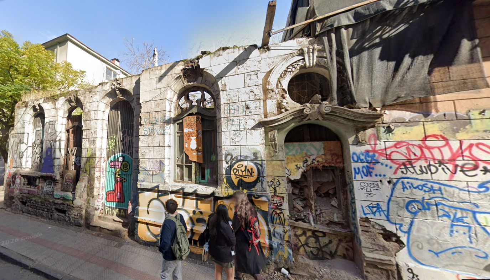

# Comparación de modelos para la miniaplicación

**Fecha de la tabla:** 20-10-2026

Proyecto: detección de propiedades en posible abandono en Barrio Brasil y Concha y Toro (Comunidad Brasil Alameda).

## Tabla comparativa

| Criterio | Claude Haiku 5.5 | Claude Sonnet 5.5 | Claude Opus 5.5 | Haiku 5.5 (CLP) | Sonnet 5.5 (CLP) | Opus 5.5 (CLP) |
|---|---|---|---|---|---|---|
| **Costo por 1000 tokens de entrada** | 0,0001 USD | 0,002 USD | 0,004 USD | 0,098 CLP | 1,96 CLP | 3,93 CLP |
| **Costo por 1000 tokens de salida** | 0,0005 USD | 0,01 USD | 0,02 USD | 0,491 CLP | 9,82 CLP | 19,64 CLP |
| **Latencia promedio observada** | 4,99 segundos | 7,66 segundos | 8,63 segundos | — | — | — |
| **Calidad de respuesta para tu caso concreto** | buena: en los 4 intentos califica la evidencia como "fuerte" o "alta" y ve los escombros, pero solo en 2 de 4 menciona que la casa perdió el techo, la señal más grave | muy buena: en los 4 intentos ve que falta el techo y los escombros, y califica la evidencia como "muy fuerte" en 3 de 4; pero no respeta el límite de 5 líneas y su latencia es la más variable (4,6 a 10,6 s) | excelente: la más consistente: en los 4 intentos ve que falta el techo y los escombros, califica la evidencia como "muy fuerte" y advierte que es una ruina estructural en riesgo | — | — | — |
| *Costo promedio por petición (medido)* | *0,000472 USD* | *0,008755 USD* | *0,014880 USD* | *0,464 CLP* | *8,60 CLP* | *14,61 CLP* |

## De dónde sale cada dato

- **Costo por 1000 tokens (USD):** página oficial de precios de Anthropic, consultada el 20-10-2026: <https://platform.claude.com/docs/en/about-claude/pricing>. Precios por millón de tokens (entrada / salida): Haiku 5.5 USD 0,10 / 0,50; Sonnet 5.5 USD 2 / 10; Opus 5.5 USD 4 / 20.
- **Conversión a CLP:** dólar observado del Banco Central de Chile del 20-10-2026, **$981,86 por dólar** (<https://www.bcentral.cl/>).
- **Latencia promedio:** medida con `src/medir_latencia.py`, que cronometra con `time.perf_counter()` el tiempo de `enviar_peticion()`. Se enviaron 4 veces la misma foto y la misma pregunta a cada modelo y se promediaron los tiempos.
- **Costo promedio por petición:** calculado con `calcular_costo()` a partir de `usage` (tokens de entrada y salida) de cada respuesta. Los tokens de entrada incluyen la foto, y los de salida incluyen el razonamiento del modelo.
- **Calidad:** evaluada leyendo las 4 respuestas de cada modelo a la misma foto real.

## Foto y prompt de prueba

La prueba usa una **foto real de Google Street View** (imagen de mayo 2024) de la propiedad de calle Almirante Barroso 256, Barrio Brasil, Santiago:

*Imagen: Google Street View, mayo 2024.*

Prompt enviado junto con la foto:

> Analiza esta foto de Google Street View de la fachada de la propiedad de calle Almirante Barroso 256, Barrio Brasil, Santiago. ¿Qué señales de posible abandono ves (por ejemplo: ventanas tapiadas, malezas, grafitis, pintura descascarada) y qué tan fuerte es la evidencia? Responde en máximo 5 líneas.

## Mediciones individuales

| Intento | Haiku 5.5 | Sonnet 5.5 | Opus 5.5 |
|---|---|---|---|
| 1 | 5,35 s · 0,000438 USD | 10,62 s · 0,009940 USD | 9,06 s · 0,013720 USD |
| 2 | 5,26 s · 0,000507 USD | 8,13 s · 0,009710 USD | 8,38 s · 0,015680 USD |
| 3 | 4,60 s · 0,000475 USD | 7,28 s · 0,008640 USD | 7,97 s · 0,015220 USD |
| 4 | 4,74 s · 0,000469 USD | 4,60 s · 0,006730 USD | 9,11 s · 0,014900 USD |
| **Promedio** | **4,99 s · 0,000472 USD** | **7,66 s · 0,008755 USD** | **8,63 s · 0,014880 USD** |

## Qué detectó cada modelo en la foto

| | Haiku 5.5 | Sonnet 5.5 | Opus 5.5 |
|---|---|---|---|
| Ve que la casa perdió el techo | 2 de 4 intentos | 4 de 4 | 4 de 4 |
| Ve los escombros tras la puerta | 4 de 4 | 4 de 4 | 4 de 4 |
| Cómo califica la evidencia | "fuerte" o "alta" (4 de 4) | "muy fuerte" (3 de 4) y "fuerte" (1 de 4) | "muy fuerte" (4 de 4) |

Los tres modelos también nombraron los grafitis en toda la fachada, el revoque caído con ladrillo expuesto, los vanos con tablas o rejas, la lona y la vegetación sobre la cornisa.

Referencia de escala: procesar 1000 propiedades costaría unos $464 CLP con Haiku 5.5, $8.596 CLP con Sonnet 5.5 y $14.610 CLP con Opus 5.5.
