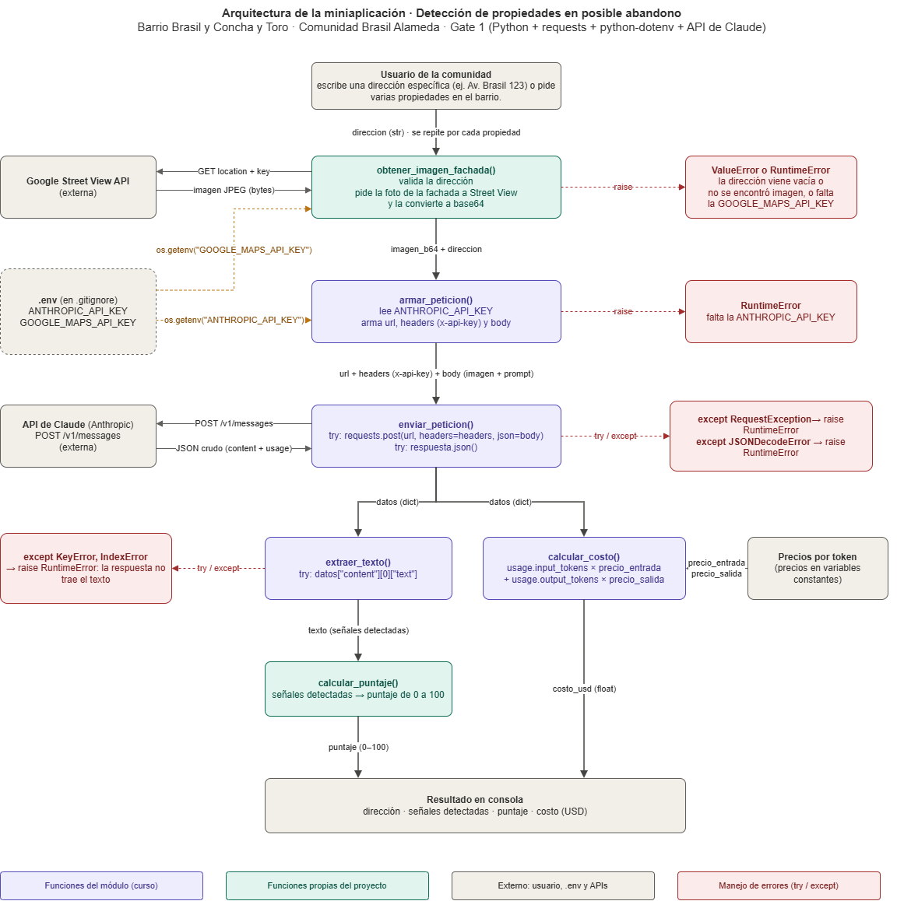

# Decisión de arquitectura: elección de modelo

**Fecha:** 20-10-2026

Proyecto: detección de propiedades en posible abandono en Barrio Brasil y Concha y Toro (Comunidad Brasil Alameda).

La miniaplicación evalúa cada propiedad a partir de la foto de su fachada: el modelo busca señales visibles de posible abandono, como ventanas tapiadas, malezas o vegetación en el techo, grafitis o pintura descascarada, y con esas señales mi código calcula un puntaje de abandono de 0 a 100.

## Modelo elegido

**Claude Opus 5.5** (`claude-opus-5-5`), de Anthropic, usado a través de la API de Claude (`POST /v1/messages`).

## Diagrama de arquitectura

## Comparación de candidatos

Tabla armada el 20-10-2026 con datos reales:

| Criterio                                       | Claude Haiku 5.5                                                                                                                                         | Claude Sonnet 5.5                                                                                                                                                                 | Claude Opus 5.5                                                                                                                                                                                                                                  | Haiku 5.5 (CLP) | Sonnet 5.5 (CLP) | Opus 5.5 (CLP) |
| ---------------------------------------------- | -------------------------------------------------------------------------------------------------------------------------------------------------------- | --------------------------------------------------------------------------------------------------------------------------------------------------------------------------------- | ------------------------------------------------------------------------------------------------------------------------------------------------------------------------------------------------------------------------------------------------ | --------------- | ---------------- | -------------- |
| **Costo por 1000 tokens de entrada**           | 0,0001 USD                                                                                                                                               | 0,002 USD                                                                                                                                                                         | 0,004 USD                                                                                                                                                                                                                                        | 0,098 CLP       | 1,96 CLP         | 3,93 CLP       |
| **Costo por 1000 tokens de salida**            | 0,0005 USD                                                                                                                                               | 0,01 USD                                                                                                                                                                          | 0,02 USD                                                                                                                                                                                                                                         | 0,491 CLP       | 9,82 CLP         | 19,64 CLP      |
| **Latencia promedio observada**                | 3,59 segundos                                                                                                                                            | 4,85 segundos                                                                                                                                                                     | 6,27 segundos                                                                                                                                                                                                                                    | —               | —                | —              |
| **Calidad de respuesta para tu caso concreto** | buena: evalúa las 4 señales descritas y advierte que no son concluyentes, pero su conclusión cambia entre intentos (de "moderada" a "moderada a fuerte") | muy buena: siempre responde con el mismo formato (fuerte / moderada / conclusión), fácil de llevar a un puntaje, pero cambia qué señales considera "fuertes" de un intento a otro | excelente: la más consistente (en los 4 intentos marca las ventanas tapiadas y la vegetación como las señales más fuertes) y la que más contexto del Barrio Brasil aporta (grafitis comunes en casas habitadas, Zona Típica, sucesión o litigio) | —               | —                | —              |
| _Costo promedio por petición (medido)_         | _0,000284 USD_                                                                                                                                           | _0,004080 USD_                                                                                                                                                                    | _0,009240 USD_                                                                                                                                                                                                                                   | _0,279 CLP_     | _4,01 CLP_       | _9,07 CLP_     |

Fuentes: precios de la [página oficial de Anthropic](https://platform.claude.com/docs/en/about-claude/pricing) y dólar observado del Banco Central de Chile del 20-10-2026 ($981,86). La latencia y el costo por petición se midieron con `src/medir_latencia.py` (4 repeticiones del mismo prompt por modelo). El detalle de cada medición y el prompt de prueba están en [comparacion_modelos.md](comparacion_modelos.md).

## Justificación

Elegí Claude Opus 5.5 porque para mi miniaplicación el criterio que más pesa es la calidad: el puntaje de abandono depende de que el modelo identifique las mismas señales cada vez. En las 4 repeticiones, Opus marcó siempre las ventanas tapiadas y la vegetación como las señales más fuertes, y fue el que más contexto del Barrio Brasil aportó. Como el Gate 1 es un prototipo que se corre pocas veces, el costo (unos US$0,009, alrededor de $9 CLP por propiedad) pesa poco, y 6,3 segundos de latencia es aceptable porque no es un chat en tiempo real.

## Alternativa descartada y por qué

Descarté Claude Haiku 5.5: es 33 veces más barato y casi el doble de rápido, pero su conclusión cambió entre intentos (de "moderada" a "moderada a fuerte"), lo que haría variar el puntaje de una misma propiedad. También descarté Claude Sonnet 5.5: su formato es ordenado, pero cambió qué señales consideraba fuertes de un intento a otro, y su menor costo no compensa esa inconsistencia. Si en el Gate 2 proceso todo el barrio (miles de propiedades), volveré a evaluar Haiku 5.5 por costo.
